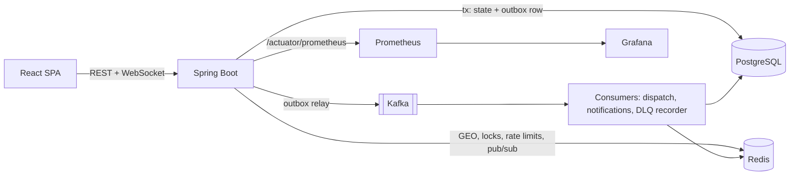

# Architecture

**Source of truth:** PostgreSQL. Redis holds disposable, rebuildable state (driver positions, locks, counters). Kafka carries facts that already committed.

**Write path (order creation):** `POST /orders` -> one transaction writes the order, its timeline row and an `outbox_events` row -> relay publishes `order.created` -> consumer moves the order to `DISPATCH_REQUESTED` and writes another outbox row -> `dispatch.requested` -> dispatch engine assigns a driver in its own transaction and writes `driver.assigned`.

**Read path:** dashboard and analytics are tenant-scoped SQL aggregates. The live map combines a Postgres snapshot with Redis GEO positions and a WebSocket stream.

Packages: `auth`, `account` (tokens, invitations, team), `fleet` (orders/drivers/vehicles), `outbox`, `dispatch`, `events` (Kafka), `live` (WebSocket), `notify`, `analytics`, `dashboard`, `ops` (metrics, fault injection), `seed`.
